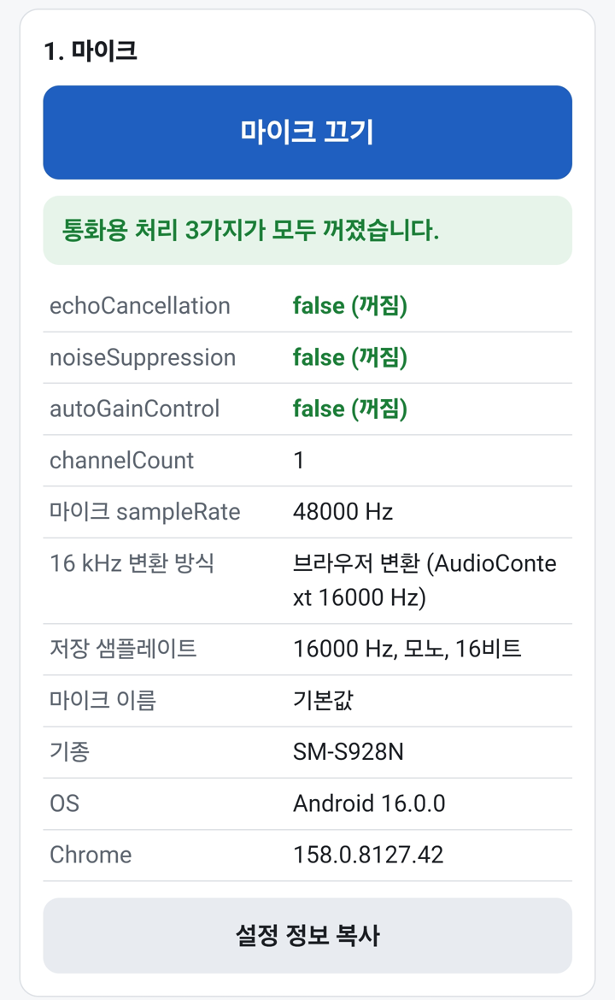
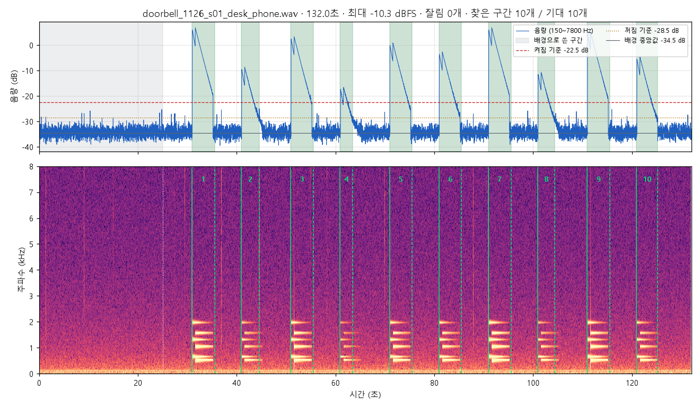
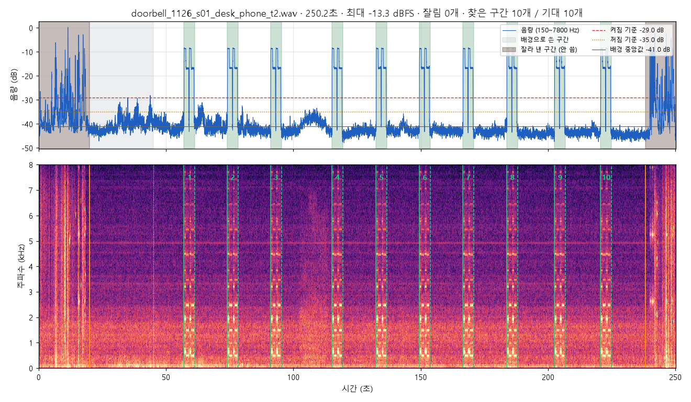
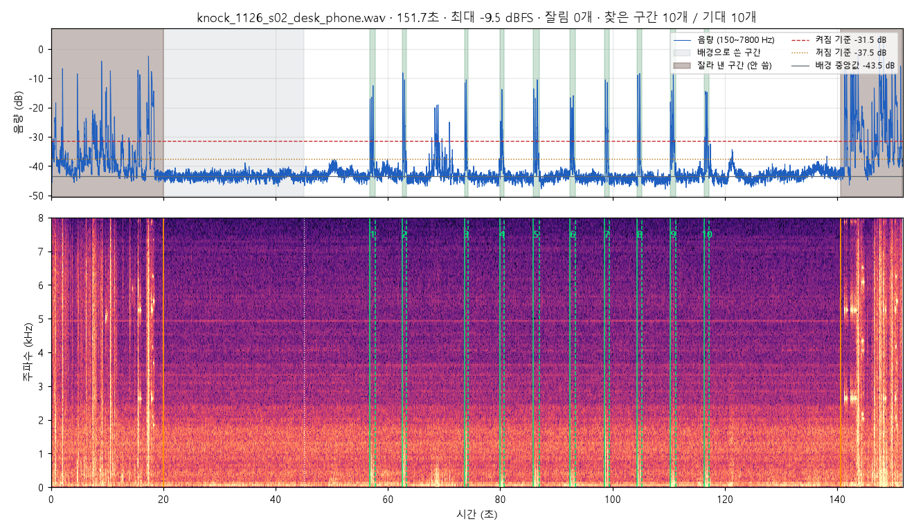

# 2주차 진도보고서 (11/26~12/3)

> 작성 중. 작업이 끝날 때마다 고친다. 마지막 수정: 2026-11-26 (1단계-2 완료)

## 한눈에 보기

- 목표: 휴대폰 크롬 안에서 소리 입력부터 판단까지 하는 구조로 다시 만들고, 휴대폰 경로 데이터를 모은다.
- 휴대폰 녹음 페이지 완성. 통화용 처리 3가지 모두 꺼짐 확인 (false 3개)
- 4 kHz 위 높은 소리 보존: 4~7.8 kHz 세기가 바닥보다 61.9 dB 올라감
- 첫 실제 회차 자동 구간 찾기: 초인종 10/10, 노크 10/10 (앞뒤 잡음 제거 후)

## 1. 이번 주 목표

### 재설계 배경

1주차: 노트북 마이크 기준으로 모델과 실시간 알림을 만들었다. 공개 데이터 시험 macro-F1 0.84.

발표 후 설계를 처음부터 다시 했다. 교수님 허락을 받았다(11/26).

| 문제 | 내용 |
| --- | --- |
| 목표와 맞지 않는 환경 | 목표는 휴대폰으로 듣고 알리기. 노트북 마이크 결과로는 휴대폰 성능을 증명할 수 없다. |
| 지름길 학습 | 모델이 소리 대신 쉬운 단서를 외웠다. '그 외' 소리를 저음질로 바꾸면 82%를 아기 울음으로 판단했다. |
| 지름길 학습 | 환풍기 소리만 나는 구간을 초인종으로 판단했다(40번 중 16번). |
| 시험 데이터 부족 | 노크·원래 음질 아기 울음 시험 데이터 8개. 하나 틀리면 점수가 12.5%p 움직인다. |

바꾼 점

- 휴대폰 크롬 웹앱에서 마이크 입력부터 판단·알림까지 모두 처리한다.
- 직접 녹음도 같은 경로(웹앱 녹음 모드)로 모은다.
- 시험 데이터는 클래스마다 30개 이상을 목표로 한다.

### 이번 주 단계 (설계서 7절)

| 단계 | 기간 | 내용 | 상태 |
| --- | --- | --- | --- |
| 1 휴대폰 경로 | 11/27~28 | 녹음 페이지, 회차 확인 도구, 휴대폰 안 모델 실행 확인 | 녹음 페이지 완료, 회차 확인 완료 (11/26) |
| 2 데이터 | 11/29~12/1 | 직접 녹음, 공개 데이터 | 미시작 |
| 3 기준 모델 v1 | 12/2~3 | 증강 없는 첫 모델 | 미시작 |

## 2. 진행한 내용

### 2.1 녹음 페이지 (1단계-1, 11/26)

- 휴대폰 크롬에서 열어 녹음하고 16 kHz wav로 저장하는 페이지를 만들었다.
- 알림 앱과 **같은 마이크 경로**를 쓴다. 학습 데이터와 실제 입력을 같게 만들기 위해서다.
- 마이크 입력 부분(`web/audio-input.js`)은 알림 앱에서 그대로 다시 쓴다.

마이크 설정

- 통화용 처리 3가지를 끈다: 에코 제거, 잡음 제거, 자동 음량.
- 켜 두면 초인종·노크 같은 소리가 깎일 수 있다.
- 실제 적용된 값(`getSettings()`)을 화면에 보여 준다.

16 kHz 변환

- 모델 입력이 16 kHz라서 브라우저에서 바로 16 kHz로 바꾼다.
- 방식 1: 크롬이 바꿔 준다(AudioContext 16 kHz). 휴대폰에서 이 방식이 됐다.
- 방식 2: 방식 1이 안 되는 경우를 위한 예비. JavaScript로 직접 바꾼다.
- 저장한 wav = 모델이 받을 신호 그대로. 저장할 때 다시 바꾸지 않는다.

파일 이름과 메타데이터

- 이름 규칙: `클래스_날짜_회차_장소_phone.wav` (예: `doorbell_1126_s01_desk_phone.wav`)
- 회차 ID(예: `phone_1126_s01`)가 학습·검증·시험을 나누는 단위다.
- 저장할 때 `meta.csv`에 붙여 넣을 한 줄을 화면에 보여 준다.

배포

- GitHub Pages: https://munpin.github.io/sound-alert/
- https라서 휴대폰 마이크를 쓸 수 있다.

### 2.2 회차 확인 스크립트 (1단계-2, 11/26)

- 회차 하나를 녹음한 직후 돌려 소리 개수가 맞는지 본다(`train/check_session.py`).
- 회차가 학습·시험 분할 단위라서, 개수가 틀리면 그 자리에서 다시 녹음해야 한다.
- 앞 30초 배경으로 평소 음량을 재고, 그보다 확실히 커진 구간을 소리로 찾는다.
- 가까운 소리는 하나로 묶는다: 초인종 2초, 노크 1초.
- 찾은 구간 사이와 앞 배경은 같은 회차의 '그 외'로 적는다(설계서 4절).
- 형식·클리핑·meta.csv 줄도 함께 확인한다.

- 첫 실제 회차: 초인종 1회차, 노크 1회차 (휴대폰 책상 위, 배경 컴퓨터 팬).
- 혼자 녹음하면 나가고 들어오는 소리가 앞뒤에 들어간다. 확인할 때 앞뒤를 잘라 낸다.

### 2.3 확인 방법

- PC 시험: JS 변환 품질(사인파), PC 크롬에서 페이지 전체 동작(가짜 마이크)
- 휴대폰 시험: 설정 화면 확인, 10초 확인 녹음(조용히 → 박수 → 알림음)
- 확인 녹음은 `train/check_wav.py`로 형식·클리핑·높은 소리를 검사한다.

## 3. 결과

### 휴대폰 마이크 설정

| 항목 | 요청 | 실제 |
| --- | --- | --- |
| echoCancellation (에코 제거) | false | false |
| noiseSuppression (잡음 제거) | false | false |
| autoGainControl (자동 음량) | false | false |
| 채널 수 | 1 | 1 |
| 마이크 샘플레이트 | - | 48000 Hz |
| 16 kHz 변환 방식 | - | 브라우저 변환 |

기기: SM-S928N (갤럭시 S24 Ultra), Android 16.0.0, Chrome 158.0.8127.42

휴대폰 녹음 페이지의 설정 표. 세 가지 처리가 모두 false(꺼짐).

### 확인 녹음

| 확인 | 기준 | 결과 |
| --- | --- | --- |
| 형식 | 16000 Hz · 1채널 · 16비트 | 16000 Hz · 1채널 · 16비트 |
| 클리핑 | 잘린 샘플 0개 | 0개 (최댓값 −0.3 dBFS) |
| 4 kHz 위 소리 | 바닥보다 20 dB 이상 | 61.9 dB (−85.7 → −23.8 dB) |

위: 파형. 가운데: 스펙트로그램(가로 시간 초, 세로 주파수 kHz). 아래: 큰 구간·조용한 구간 평균 스펙트럼. 박수(2.8~4.7초)는 0~8 kHz 전체, 알림음(6초~)은 가로줄로 보인다.

### JS 변환(예비 방식) 품질 — PC 시험

| 입력 (48 kHz) | 출력 세기 |
| --- | --- |
| 100 / 1000 / 3900 / 6000 Hz | 0.0 dB (그대로) |
| 7000 Hz | −2.6 dB |
| 7600 Hz | −21.1 dB |
| 9000 Hz (8 kHz 위 → 접혀 들어오는 성분) | −87.7 dB |

### 회차 확인 — 합성 회차 시험

먼저 합성 파일로 시험했다.

| 시험 파일 | 넣은 소리 | 찾은 구간 | 간격 |
| --- | --- | --- | --- |
| 합성 초인종 회차 | 배경 30초 + 10번 (크기 0.02~0.3) | 10개 | 10.0초 |
| 합성 노크 회차 | 배경 30초 + 10묶음 (2~3번 두드림) | 10개 | 5.0초 |

위: 10 ms 음량(dB)과 기준선, 회색은 배경으로 쓴 구간, 초록은 찾은 구간. 아래: 스펙트로그램(가로 시간 초, 세로 주파수 kHz)과 구간 번호.

### 회차 확인 — 첫 실제 회차

| 회차 | 1차 (자르기 없이) | 2차 | 기대 |
| --- | --- | --- | --- |
| 초인종 s01 | 15개 | 10개 (앞 20초·뒤 12초 잘라 냄) | 10개 |
| 노크 s02 | 17개 | 10개 (앞 20초·뒤 11초 잘라 냄, 잡음 2개 제외) | 10개 |

초인종 회차. 갈색은 잘라 낸 구간(나가고 들어오는 소리), 회색은 배경, 초록은 찾은 초인종 10개.

노크 회차. 3·4번(67~71초)은 노크보다 작은 다른 소리라 '그 외'로 돌렸다.

## 4. 발견한 문제와 해결

| 문제 | 원인 | 해결 |
| --- | --- | --- |
| 첫 배포 실패 | push 때 저장소 Pages 설정이 꺼져 있었다 | Pages 설정(Source: GitHub Actions) 후 다시 실행 → 성공 |
| 가까운 박수가 잘림 직전 (−0.3 dBFS) | 휴대폰 바로 앞에서 손뼉 | 녹음 때 화면의 클리핑 경고를 보고 거리를 띄운다 |
| 녹음 끝 최대 50 ms 빠짐 | 소리를 800개(50 ms) 묶음으로 받는다 | 회차 녹음(수십 초~수 분)에는 영향이 작아 그대로 둔다 |
| 첫 실제 회차에서 15개·17개를 찾음 (기대 10개) | 혼자 녹음해서 나가고 들어오는 발소리·문소리가 앞뒤에 들어감 | 앞뒤 잘라 내기 옵션 추가 (`--skip-start`, `--skip-end`) → 초인종 10개 |
| 노크 회차에서 작은 잡음 2개를 노크로 셈 | 노크와 크기 차이가 2~3 dB뿐 (잡음 +24.4 dB, 가장 작은 노크 +27.6 dB) | 그림을 보고 번호로 제외하는 옵션 추가 (`--drop`) → 10개 |
| 작은 초인종 구간이 일찍 끝남 (합성 4번 2.58초, 큰 소리 4.58초) | 울림 끝이 배경 수준 가까이 작아져 꺼짐 기준 아래로 내려감 | 아직 못 함. 꼬리가 '그 외'로 들어간다. 2단계에서 학습용 창을 자를 때 처리 |

## 5. 결정과 이유

| 결정 | 이유 |
| --- | --- |
| 1주차 코드·데이터를 쓰지 않고 새로 시작 | 노트북 경로 결과는 휴대폰 성능을 증명하지 못한다 |
| 기본 녹음 앱 대신 웹앱 녹음 모드 | 기본 녹음 앱은 소리 처리가 달라 실제 입력과 달라진다 |
| `web/` 폴더만 배포 (GitHub Actions) | 학습 코드와 문서는 휴대폰에 필요 없다 |
| 같은 이름 재저장 시 `_t2`, `_t3` 붙임 | 회차 앞뒤 배경 녹음 두 개가 같은 이름이 된다. 회차 ID는 그대로 둔다 |
| 장소 이름에 밑줄 금지 | 파일 이름을 `_`로 다시 나눌 수 있게 |

설계서와 달라진 점: 없음.

## 6. 다음 주 계획

이번 주 남은 일 (설계서 7절)

- 1단계 나머지: 휴대폰에서 모델 실행 확인 (가장 큰 위험, 설계서 8절)
- 2단계: 초인종·노크 회차 녹음, 공개 데이터 받기
- 3단계: 기준 모델 v1 학습과 휴대폰 시험셋 점수

3주차 (12/4~10)

- 4단계: 개선 실험 (배경 소음 섞기, 스피커 재녹음 등)

## 핵심 숫자

| 숫자 | 값 | 출처 파일 |
| --- | --- | --- |
| 1주차 공개 데이터 시험 macro-F1 | 0.84 | `CLAUDE.md` (1주차 결과) |
| 1주차 저음질 '그 외' → 아기 울음 판단 비율 | 82% | `CLAUDE.md` (1주차 결과) |
| 1주차 환풍기 구간 → 초인종 판단 | 40번 중 16번 | `CLAUDE.md` (1주차 결과) |
| 1주차 노크·원래 음질 아기 울음 시험 개수 | 8개 | `CLAUDE.md` (1주차 결과) |
| 통화용 처리 3가지 실제 값 | 모두 false | `docs/figures/phone_settings_1126.png` |
| 휴대폰 마이크 샘플레이트 | 48000 Hz | `docs/figures/phone_settings_1126.png` |
| 휴대폰 크롬 버전 | 158.0.8127.42 | `docs/figures/phone_settings_1126.png` |
| 확인 녹음 길이 | 11.20초 (179200 샘플) | `docs/logs/check_recording_1126.txt` |
| 확인 녹음 최댓값 | 31549 / 32768 (−0.3 dBFS) | `docs/logs/check_recording_1126.txt` |
| 확인 녹음 잘린 샘플 | 0개 | `docs/logs/check_recording_1126.txt` |
| 4~7.8 kHz 세기 바닥 → 최대 | −85.7 → −23.8 dB (61.9 dB 차이) | `docs/logs/check_recording_1126.txt` |
| JS 변환 7000 Hz 세기 | −2.6 dB (48 kHz 입력) | `docs/logs/resample_test_1126.txt` |
| JS 변환 9000 Hz 접힘 성분 | −87.7 dB (48 kHz 입력) | `docs/logs/resample_test_1126.txt` |
| PC 크롬 4초 녹음 샘플 수 | 64000 (4.00초) | `docs/logs/e2e_chrome_1126.txt` |
| 합성 초인종 회차 찾은 구간 | 10개 / 기대 10개 | `docs/logs/session_check_synth_1126.txt` |
| 합성 노크 회차 찾은 구간 | 10개 / 기대 10개 | `docs/logs/session_check_synth_1126.txt` |
| 합성 초인종 가장 작은 소리 | 배경보다 +17.9 dB | `docs/logs/session_check_synth_1126.txt` |
| 실제 초인종 회차 찾은 구간 (자르기 전 → 후) | 15개 → 10개 | `docs/logs/session_check_real_1126.txt` |
| 실제 노크 회차 찾은 구간 (자르기 전 → 자르기 후 → 잡음 제외 후) | 17개 → 12개 → 10개 | `docs/logs/session_check_real_1126.txt` |
| 실제 초인종 한 번 길이 | 4.27~4.32초 | `docs/logs/session_check_real_1126.txt` |

## 예상 질문과 답

**Q. 왜 앱이 아니라 웹앱인가?**
3주 안에 완성할 수 있고 링크 하나로 설치된다. 화면이 꺼지면 멈추는 점은 한계로 밝힌다.

**Q. 통화용 처리를 왜 끄나?**
통화용 처리는 사람 목소리만 남기려고 다른 소리를 깎는다. 초인종·노크가 깎일 수 있다.

**Q. 크롬이 끄기 요청을 무시하면?**
`getSettings()`로 실제 값을 확인했고 셋 다 false였다. 학습 데이터도 같은 경로로 모으므로 학습과 사용이 일치한다.

**Q. 왜 16 kHz인가? 높은 소리가 사라지지 않나?**
16 kHz는 8 kHz까지 담는다. 확인 녹음에서 4~8 kHz 소리가 남는 것을 스펙트로그램으로 확인했다.

**Q. 삼성 기본 녹음 앱으로 녹음하면 안 되나?**
기본 녹음 앱은 소리 처리가 달라 실제 사용할 때 들어오는 소리와 달라진다.

**Q. 16 kHz 변환이 정확한지 어떻게 아나?**
휴대폰은 크롬 내장 변환을 쓰고, 확인 녹음 스펙트로그램으로 확인했다. 예비 JS 변환은 사인파로 6 kHz까지 0.0 dB임을 확인했다.

**Q. 데이터는 왜 저장소에 안 올리나?**
공개 데이터 이용 조건(비상업용, 배포 금지) 때문이다. 모델 파일만 배포한다.

**Q. 소리 구간은 사람이 직접 표시하나?**
아니다. 배경보다 확실히 커진 구간을 스크립트가 찾고, 누른 횟수와 개수가 같은지만 사람이 확인한다.

**Q. 자동 구간 찾기가 맞는지 어떻게 아나?**
합성 회차와 첫 실제 회차(초인종·노크 각 10번)에서 10개를 찾았다. 실제 회차는 앞뒤 잡음을 잘라 내고, 노크 회차의 작은 잡음 2개는 그림을 보고 제외했다.
