# 2주차 진도보고서 (11/26~12/3)

> 작성 중. 작업이 끝날 때마다 고친다. 마지막 수정: 2026-11-27 (스피커 재녹음 6개 완료: 183개 창, 시험 A에 사이렌·경적·아기 울음)

## 한눈에 보기

- 목표: 휴대폰 크롬 안에서 소리 입력부터 판단까지 하는 구조로 다시 만들고, 휴대폰 경로 데이터를 모은다.
- 휴대폰 크롬 안에서 모델 실행: 1회 평균 8.87 ms (기준 100 ms), PyTorch와 차이 최대 1.96e-05
- 공개 데이터 5종 + 직접 녹음을 2초 창 6,403개 표로 모음. 여러 분할에 걸친 묶음 0개
- 공개 데이터에 크롬 16 kHz 변환 모양을 입힘: PC 크롬 실측과 평균 차이 0.55 dB 이하 (0.5~7.8 kHz)
- 휴대폰 크롬 변환 모양 = PC 크롬: 구간별 평균 차이 최대 0.10 dB
- 스피커 재녹음 185개 중 183개 사용 → 시험 A: 사이렌 30, 경적 30, 아기 울음 48

## 1. 이번 주 목표

### 재설계 배경

1주차: 노트북 마이크 기준으로 모델과 실시간 알림을 만들었다. 공개 데이터 시험 macro-F1 0.84.

발표 후 설계를 처음부터 다시 했다. 교수님 허락을 받았다(11/26).

| 문제 | 내용 |
| --- | --- |
| 목표와 맞지 않는 환경 | 목표는 휴대폰으로 듣고 알리기. 노트북 마이크 결과로는 휴대폰 성능을 증명할 수 없다. |
| 지름길 학습 | 모델이 소리 대신 쉬운 단서를 외웠다. '그 외' 소리를 저음질로 바꾸면 82%를 아기 울음으로 판단했다. |
| 지름길 학습 | 환풍기 소리만 나는 구간을 초인종으로 판단했다(40번 중 16번). |
| 시험 데이터 부족 | 노크·원래 음질 아기 울음 시험 데이터 8개. 하나 틀리면 점수가 12.5%p 움직인다. |

바꾼 점

- 휴대폰 크롬 웹앱에서 마이크 입력부터 판단·알림까지 모두 처리한다.
- 직접 녹음도 같은 경로(웹앱 녹음 모드)로 모은다.
- 시험 데이터는 클래스마다 30개 이상을 목표로 한다.

### 이번 주 단계 (설계서 7절)

| 단계 | 기간 | 내용 | 상태 |
| --- | --- | --- | --- |
| 1 휴대폰 경로 | 11/27~28 | 녹음 페이지, 회차 확인 도구, 휴대폰 안 모델 실행 확인 | 완료 (11/26) |
| 2 데이터 | 11/29~12/1 | 직접 녹음, 공개 데이터 | 공개 데이터·표 완료 (11/27). 직접 녹음 회차·스피커 재녹음 남음 |
| 3 기준 모델 v1 | 12/2~3 | 증강 없는 첫 모델 | 미시작 |

## 2. 진행한 내용

### 2.1 녹음 페이지 (1단계-1, 11/26)

- 휴대폰 크롬에서 열어 녹음하고 16 kHz wav로 저장하는 페이지를 만들었다.
- 알림 앱과 **같은 마이크 경로**를 쓴다. 학습 데이터와 실제 입력을 같게 만들기 위해서다.
- 마이크 입력 부분(`web/audio-input.js`)은 알림 앱에서 그대로 다시 쓴다.

마이크 설정

- 통화용 처리 3가지를 끈다: 에코 제거, 잡음 제거, 자동 음량.
- 켜 두면 초인종·노크 같은 소리가 깎일 수 있다.
- 실제 적용된 값(`getSettings()`)을 화면에 보여 준다.

16 kHz 변환

- 모델 입력이 16 kHz라서 브라우저에서 바로 16 kHz로 바꾼다.
- 방식 1: 크롬이 바꿔 준다(AudioContext 16 kHz). 휴대폰에서 이 방식이 됐다.
- 방식 2: 방식 1이 안 되는 경우를 위한 예비. JavaScript로 직접 바꾼다.
- 저장한 wav = 모델이 받을 신호 그대로. 저장할 때 다시 바꾸지 않는다.

파일 이름과 메타데이터

- 이름 규칙: `클래스_날짜_회차_장소_phone.wav` (예: `doorbell_1126_s01_desk_phone.wav`)
- 회차 ID(예: `phone_1126_s01`)가 학습·검증·시험을 나누는 단위다.
- 저장할 때 `meta.csv`에 붙여 넣을 한 줄을 화면에 보여 준다.

배포

- GitHub Pages: https://munpin.github.io/sound-alert/
- https라서 휴대폰 마이크를 쓸 수 있다.

### 2.2 회차 확인 스크립트 (1단계-2, 11/26)

- 회차 하나를 녹음한 직후 돌려 소리 개수가 맞는지 본다(`train/check_session.py`).
- 회차가 학습·시험 분할 단위라서, 개수가 틀리면 그 자리에서 다시 녹음해야 한다.
- 앞 30초 배경으로 평소 음량을 재고, 그보다 확실히 커진 구간을 소리로 찾는다.
- 가까운 소리는 하나로 묶는다: 초인종 2초, 노크 1초.
- 찾은 구간 사이와 앞 배경은 같은 회차의 '그 외'로 적는다(설계서 4절).
- 형식·클리핑·meta.csv 줄도 함께 확인한다.

- 첫 실제 회차: 초인종 1회차, 노크 1회차 (휴대폰 책상 위, 배경 컴퓨터 팬).
- 혼자 녹음하면 나가고 들어오는 소리가 앞뒤에 들어간다. 확인할 때 앞뒤를 잘라 낸다.

### 2.3 휴대폰 안에서 모델 실행 확인 (1단계-3, 11/26)

- 설계서 8절의 가장 큰 위험: 휴대폰 크롬 안에서 모델이 도는가.
- 학습하지 않은 임시 모델로 확인했다. 출력 확률 자체는 의미가 없다.
- 전처리(음량 정규화, 멜 변환)까지 모델 파일(ONNX) 하나에 넣었다. 학습과 휴대폰이 같은 계산을 한다.
- STFT는 합성곱으로 만들었다. 브라우저에서 확실히 도는 기본 연산만 쓰기 위해서다.
- 휴대폰에서는 onnxruntime-web 1.31.1로 실행한다. 파일을 사이트에 함께 넣었다(나중 오프라인 동작용).
- 확인: 같은 입력 4개로 PyTorch와 결과 비교, 100번 실행 속도, 마이크 실시간.

### 2.4 공개 데이터 (2단계, 11/27)

모든 공개 데이터를 같은 규칙으로 바꾼다.

- 한 줄 = 2초 창 하나. 소리가 2초보다 길면 가장 큰 2초를 쓴다.
- 묶음(같은 장소·같은 사람·같은 아기)은 한 분할에만 넣는다. 학습·시험이 섞이지 않게 하기 위해서다.
- 16 kHz로 바꿀 때 휴대폰 크롬의 변환 모양을 입힌다(아래).

| 출처 | 쓰는 클래스 | 묶음 기준 | 분할 방법 |
| --- | --- | --- | --- |
| AI Hub 도시 소리 | 사이렌, 경적(차량·이륜차), 그 외(주행음, 생활 소음 8종) | 녹음 날짜 + 시 + 구 | 70/15/15, 묶음 수 비율도 맞춤 |
| ESC-50 | 5종 모두 (노크, 아기 울음, 사이렌, 경적, 나머지는 그 외) | 원본 녹음 | fold 1~3 학습, 4 검증, 5 시험 |
| FSD50K 개발용 | 노크 | 올린 사람 | 70/15/15 |
| CryCeleb2023 | 아기 울음 | 아기 ID | 70/15/15 |
| AudioSet 평가용 | 아기 울음 | 영상 ID | 전부 시험 |

### 2.5 크롬 변환 모양 맞추기 (2단계, 11/27)

- 휴대폰 녹음은 크롬이 48 kHz를 16 kHz로 바꾼다.
- 크롬 변환은 6,375 Hz에서 이미 −1 dB 줄어든다. 일반 변환기(soxr)는 7,562 Hz에서 −1 dB다.
- 공개 데이터를 soxr로만 바꾸면 높은 소리 차이가 "공개 데이터냐 휴대폰이냐"를 알려 주는 단서가 된다.
- 그래서 공개 데이터도 크롬과 같은 모양으로 높은 소리를 줄인다.
- 방법: 48 kHz로 바꾼 뒤 크롬 모양 필터 → 16 kHz.

### 2.6 아기 울음 데이터 (2단계, 11/27)

- CryCeleb는 숨을 내쉬는 울음 조각만 잘라 둔 데이터다. 조각 길이 중앙값 0.78초.
- 실제 울음은 "울음, 숨, 울음"이 이어진다.
- 같은 녹음의 조각을 순서대로 이어 붙였다. 사이 간격 0.2~0.4초.
- 간격은 완전한 무음 대신 아주 작은 잡음으로 채웠다. 무음이 아기 울음만의 단서가 되지 않게.
- AudioSet: 10초 영상 중 가장 큰 2초를 자동으로 골랐다.
- AudioSet에서 높은 소리가 7 kHz 아래까지만 있는 6개는 뺐다. 1주차 저음질 지름길을 피하기 위해서다.

### 2.7 직접 녹음 처리와 재녹음 도구 (2단계, 11/27)

- 혼자 녹음할 때 나가고 들어오는 발소리·문소리는 버리지 않고 같은 회차의 '그 외'로 남긴다.
- 노크와 헷갈리기 쉬운 소리라 '그 외' 학습에 쓸모가 있다.
- 소리 끝 1초, 시작 0.3초 근처는 '그 외'로 쓰지 않는다. 초인종 울림 꼬리가 섞이지 않게.
- 스피커 재녹음 도구: 공개 데이터를 이어 붙인 재생 파일을 틀고, 휴대폰으로 녹음한 파일을 2초씩 자동으로 자른다.
- 재생 파일 앞뒤에 1 kHz 신호음을 넣어 시각을 맞춘다.

### 2.8 2단계 결과 보고 후 고친 것 (11/27)

1. **경적 시험을 60개로 줄이고 차량·이륜차를 반씩**
   - 전에는 경적 시험 308개 중 292개가 이륜차 경적이었다. 경적 점수가 사실상 이륜차 점수였다.
   - 학습에 있던 차량경적만 든 묶음 하나(양주시 도하리, 2021-10-26)를 시험으로 옮겼다. 차량경적 시험 묶음이 작아 15% 비율보다 시험을 우선했다.
   - 같은 장소의 다른 날짜 녹음이 학습에 없는 묶음을 골랐다(영등포동은 다른 날짜가 학습에 있어 뺌).
   - 시험 = AI Hub 차량경적 22 + ESC-50 car_horn 8 (차량 30) + AI Hub 이륜차경적 30.
   - meta.csv에 `subclass` 칸을 넣어 차량/이륜차를 나눠 점수를 낼 수 있게 했다.
2. **아기 울음 점수를 출처별로**
   - meta.csv에 `orig_source` 칸을 넣었다. 재녹음 파일도 원본의 출처(AudioSet, ESC-50, CryCeleb)가 남는다.
   - 재녹음 시험 50개: AudioSet 27 → ESC-50 시험 8 → 모자란 15개만 CryCeleb. 실제 영상 소리를 먼저 넣기 위해서다.
3. **휴대폰 크롬 변환 모양 측정 기능**
   - 공개 데이터 필터는 PC 크롬 측정으로 만들었다. 휴대폰 크롬도 같은지 확인해야 한다.
   - model-test 페이지에 측정을 넣었다: 48 kHz 백색 잡음 → MediaStream → 16 kHz AudioContext. 마이크와 같은 경로다.
4. **직접 녹음 s01(초인종), s02(노크)는 학습으로**
5. **재녹음 시계 어긋남 보정을 샘플 단위로**
   - 재생 PC와 휴대폰의 시계는 조금 다르게 간다. 앞뒤 신호음 사이 길이로 늘이거나 줄여 맞춘다.
   - 전에는 신호음을 10 ms 단위로 찾아 몇 ms짜리 어긋남을 못 잡았다. 이제 샘플(1/16 ms) 단위로 찾는다.

### 2.9 확인 방법

- PC 시험: JS 변환 품질(사인파), PC 크롬에서 페이지 전체 동작(가짜 마이크)
- 휴대폰 시험: 설정 화면 확인, 10초 확인 녹음(조용히 → 박수 → 알림음)
- 확인 녹음은 `train/check_wav.py`로 형식·클리핑·높은 소리를 검사한다.

## 3. 결과

### 휴대폰 마이크 설정

| 항목 | 요청 | 실제 |
| --- | --- | --- |
| echoCancellation (에코 제거) | false | false |
| noiseSuppression (잡음 제거) | false | false |
| autoGainControl (자동 음량) | false | false |
| 채널 수 | 1 | 1 |
| 마이크 샘플레이트 | - | 48000 Hz |
| 16 kHz 변환 방식 | - | 브라우저 변환 |

기기: SM-S928N (갤럭시 S24 Ultra), Android 16.0.0, Chrome 158.0.8127.42

휴대폰 녹음 페이지의 설정 표. 세 가지 처리가 모두 false(꺼짐).

### 확인 녹음

| 확인 | 기준 | 결과 |
| --- | --- | --- |
| 형식 | 16000 Hz · 1채널 · 16비트 | 16000 Hz · 1채널 · 16비트 |
| 클리핑 | 잘린 샘플 0개 | 0개 (최댓값 −0.3 dBFS) |
| 4 kHz 위 소리 | 바닥보다 20 dB 이상 | 61.9 dB (−85.7 → −23.8 dB) |

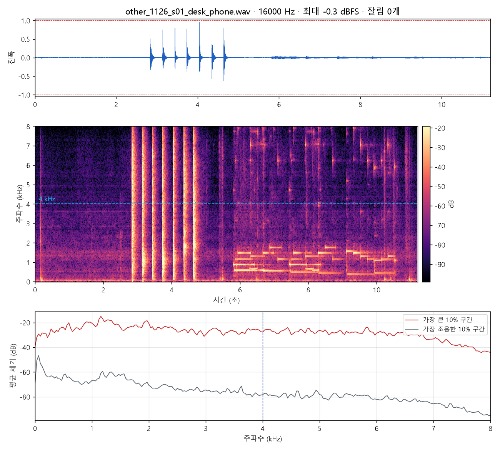

위: 파형. 가운데: 스펙트로그램(가로 시간 초, 세로 주파수 kHz). 아래: 큰 구간·조용한 구간 평균 스펙트럼. 박수(2.8~4.7초)는 0~8 kHz 전체, 알림음(6초~)은 가로줄로 보인다.

### JS 변환(예비 방식) 품질 — PC 시험

| 입력 (48 kHz) | 출력 세기 |
| --- | --- |
| 100 / 1000 / 3900 / 6000 Hz | 0.0 dB (그대로) |
| 7000 Hz | −2.6 dB |
| 7600 Hz | −21.1 dB |
| 9000 Hz (8 kHz 위 → 접혀 들어오는 성분) | −87.7 dB |

### 회차 확인 — 합성 회차 시험

먼저 합성 파일로 시험했다.

| 시험 파일 | 넣은 소리 | 찾은 구간 | 간격 |
| --- | --- | --- | --- |
| 합성 초인종 회차 | 배경 30초 + 10번 (크기 0.02~0.3) | 10개 | 10.0초 |
| 합성 노크 회차 | 배경 30초 + 10묶음 (2~3번 두드림) | 10개 | 5.0초 |

위: 10 ms 음량(dB)과 기준선, 회색은 배경으로 쓴 구간, 초록은 찾은 구간. 아래: 스펙트로그램(가로 시간 초, 세로 주파수 kHz)과 구간 번호.

### 회차 확인 — 첫 실제 회차

| 회차 | 1차 (자르기 없이) | 2차 | 기대 |
| --- | --- | --- | --- |
| 초인종 s01 | 15개 | 10개 (앞 20초·뒤 12초 잘라 냄) | 10개 |
| 노크 s02 | 17개 | 10개 (앞 20초·뒤 11초 잘라 냄, 잡음 2개 제외) | 10개 |

초인종 회차. 갈색은 잘라 낸 구간(나가고 들어오는 소리), 회색은 배경, 초록은 찾은 초인종 10개.

노크 회차. 3·4번(67~71초)은 노크보다 작은 다른 소리라 '그 외'로 돌렸다.

### 휴대폰 모델 실행 — 1단계-3

| 확인 | 기준 | wasm (기본) | WebGPU (비교용) |
| --- | --- | --- | --- |
| PyTorch와 결과 차이 (입력 4개) | 0.001 이하 | 4개 통과 (최대 1.96e-05) | 3개 실패 (최대 1.79e-02) |
| 1회 예측 평균 | 100 ms 이하 | 8.87 ms | 9.32 ms |
| 1회 예측 p95 | - | 9.3 ms | 12.6 ms |
| 첫 실행 | - | 40 ms | 552.9 ms |
| 마이크 실시간 | 0.5초마다 확률이 바뀜 | 32번 실행, 건너뜀 0번, 평균 21.68 ms. 막대가 움직이는 것을 눈으로 확인 | 시험 안 함 |

| 모델 | 값 |
| --- | --- |
| 파일 크기 | 6.81 MB (6,812,310 바이트) |
| 파라미터 | 1,524,006개 |
| 입력 → 로그 멜 | 2초 파형 32,000개 → 64 × 201 |
| Python onnxruntime vs PyTorch | 최대 차이 2.38e-05 |

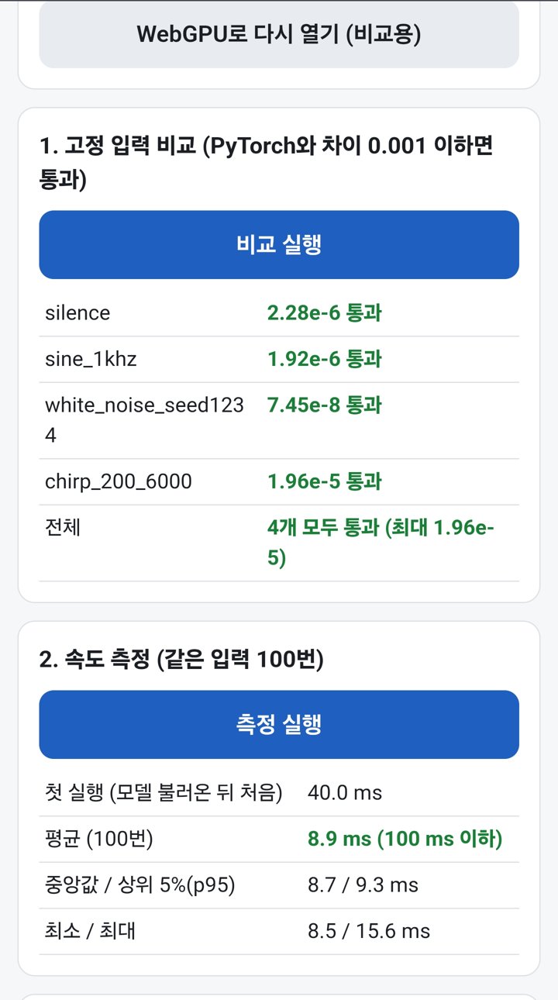

휴대폰 wasm: 고정 입력 4개 통과, 100번 평균 8.9 ms.

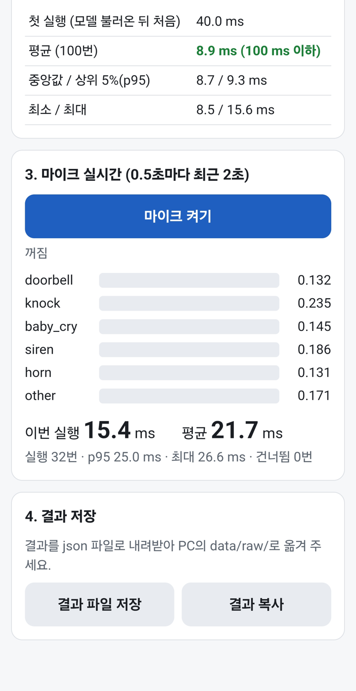

마이크 실시간 화면: 32번 실행, 평균 21.7 ms. (이때는 확률 막대가 그려지지 않는 화면 버그가 있었다. 숫자는 정상.)

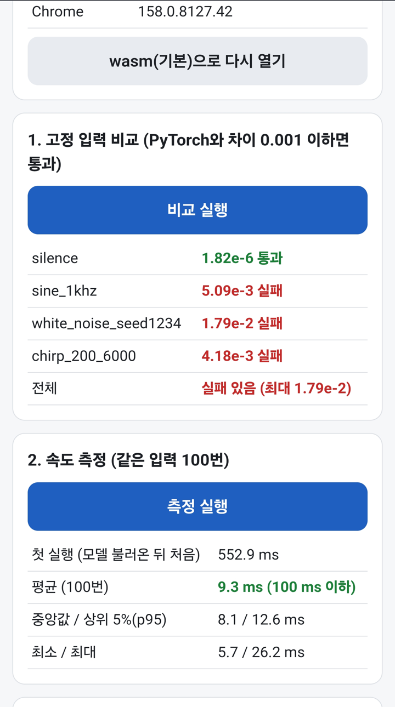

휴대폰 WebGPU: 입력 4개 중 3개가 PyTorch와 다름. 속도도 wasm보다 빠르지 않음.

### 2단계: 데이터 현황 (2초 창 개수)

| 클래스 | 학습 | 검증 | 시험 | 목표 검증 / 시험 | 시험 A (재녹음) | 시험 B (공개 원본) |
| --- | --- | --- | --- | --- | --- | --- |
| 초인종 | 10 | 0 | 0 | 20 / 30 | 0 | 0 |
| 노크 | 153 | 35 | 38 | 30 / 30 | 0 | ESC-50 8, FSD50K 30 |
| 아기 울음 | 600 | 183 | 233 | 30 / 50 | 48 | ESC-50 8, AudioSet 27, CryCeleb 150 |
| 사이렌 | 600 | 183 | 95 | 30 / 30 | 30 | ESC-50 8, AI Hub 57 |
| 경적 | 600 | 183 | 90 | 30 / 30 | 30 | ESC-50 8, AI Hub 52 |
| 그 외 | 2,400 | 515 | 668 | - | 0 | ESC-50 368, AI Hub 300 |

- 검증에도 재녹음 25개씩(사이렌, 경적, 아기 울음)이 들어 있다. 직접 녹음 s01, s02는 학습.

경적 시험 소분류 (`subclass`)

| 소분류 | 공개 원본 (묶음 수) | 재녹음 |
| --- | --- | --- |
| AI Hub 차량경적 | 22 (5) | 7 |
| ESC-50 car_horn | 8 (6) | 8 |
| AI Hub 이륜차경적 | 30 (1) | 15 |

아기 울음 원래 출처 (`orig_source`)

| 분할 | AudioSet | ESC-50 | CryCeleb |
| --- | --- | --- | --- |
| 학습 | 0 | 24 | 576 |
| 검증 (재녹음 포함) | 0 | 16 | 167 |
| 시험 (재녹음 포함) | 52 | 16 | 165 |
| 그중 재녹음 시험 | 25 | 8 | 15 |

- 시험 A(휴대폰 경로 녹음 시험): 사이렌·경적·아기 울음은 재녹음으로 채움. 초인종·노크·그 외는 0개(시험용 직접 녹음 회차 필요).
- 분할 검사: meta.csv 6,586줄, 여러 분할에 걸친 묶음 0개. 재녹음은 원본의 묶음·분할을 그대로 따른다.

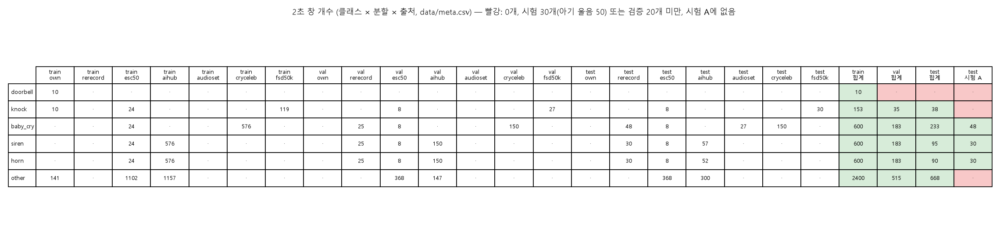

클래스 × 분할 × 출처별 2초 창 개수. 빨강은 0개이거나 목표보다 적은 칸.

### 크롬 변환 모양 맞추기

| 0.5~7.8 kHz 구간 | soxr만 | soxr + 크롬 모양 필터 |
| --- | --- | --- |
| 0.5~6.0 kHz 평균 차이 | −0.01 dB | −0.01 dB |
| 6.0~7.5 kHz 평균 차이 | 2.47 dB | 0.04 dB |
| 7.5~7.8 kHz 최대 차이 | 18.89 dB | 1.04 dB |

48 kHz 입력, 크롬 실측(PC 크롬 158)과의 차이. 휴대폰 크롬도 같은 모양임을 아래에서 확인했다.

휴대폰 측정 기능 (model-test 페이지 4번)을 PC 크롬에서 먼저 시험했다.

| PC에서 3번 측정 | 1회 | 2회 | 3회 | 예전 PC 측정 |
| --- | --- | --- | --- | --- |
| −3 dB 지점 | 6,953 Hz | 6,984 Hz | 6,984 Hz | 6,922 Hz |
| −6 dB 지점 | 7,406 Hz | 7,375 Hz | 7,359 Hz | 7,359 Hz |
| 7.0 kHz 세기 | −3.3 dB | −3.3 dB | −3.1 dB | −3.1 dB |
| 7.5 kHz 세기 | −7.4 dB | −7.4 dB | −7.5 dB | −7.7 dB |

- 마지막 측정과 예전 PC 측정의 구간별 평균 차이: 최대 0.17 dB (0.5~7.8 kHz).
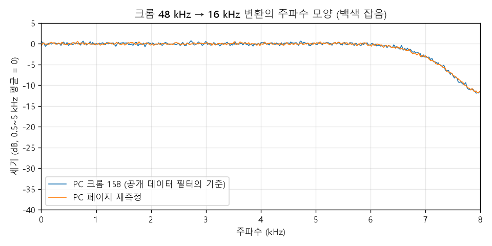

PC 크롬: 예전 측정과 새 페이지 측정의 주파수 모양(가로 주파수 kHz, 세로 세기 dB). 두 선이 겹친다.

휴대폰 측정 (갤럭시 S24 Ultra, Android 16, Chrome 158.0.8127.42, 48 kHz → 16 kHz, 20초)

| 확인 | 휴대폰 | PC 크롬 |
| --- | --- | --- |
| −1 / −3 / −6 dB 지점 | 6,547 / 6,969 / 7,375 Hz | 6,500 / 6,922 / 7,359 Hz |
| 7.0 kHz 세기 | −3.3 dB | −3.2 dB |
| 7.5 kHz 세기 | −7.9 dB | −7.7 dB |
| 7.8 kHz 세기 | −11.1 dB | −11.0 dB |

| 휴대폰 − PC | 평균 차이 | 최대 차이 |
| --- | --- | --- |
| 0.5~6.0 kHz | −0.01 dB | 0.92 dB |
| 6.0~7.5 kHz | −0.07 dB | 0.68 dB |
| 7.5~7.8 kHz | 0.10 dB | 1.07 dB |

- 구간별 평균 차이 최대 0.10 dB. PC에서 두 번 잰 차이(0.17 dB)보다 작다.
- 결론: 휴대폰 크롬과 PC 크롬의 변환이 같다. 공개 데이터 필터는 그대로 쓴다.
- 위 표의 PC 값은 같은 스크립트로 다시 계산한 값이라 예전 기록(−1 dB 6,375 Hz)과 조금 다르다.

휴대폰과 PC 크롬의 48 kHz → 16 kHz 변환 모양(가로 주파수 kHz, 세로 세기 dB, 0.5~5 kHz 평균 = 0). 두 선이 겹친다.

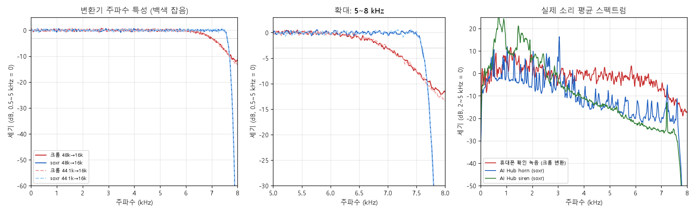

크롬과 soxr의 주파수 특성(가로 주파수 kHz, 세로 세기 dB). 크롬은 6 kHz 위부터 내려간다.

### 아기 울음: CryCeleb

| 항목 | 값 |
| --- | --- |
| 파일 / 아기 ID / 녹음 | 26,093개 / 946개 / 1,334개 |
| 형식 | 모두 16 kHz, 모노, 16비트 |
| 조각 길이 중앙값 | 0.78초 (2초 이상 4.3%) |
| 높은 소리 대역폭 | 모든 녹음 7.8 kHz 이상 |
| 쓴 부분 | train·dev 부분 아기 626명 |
| 아기 분할 | 학습 438명, 검증 94명, 시험 94명 |
| 고른 창 | 학습 600, 검증 150, 시험 150 |

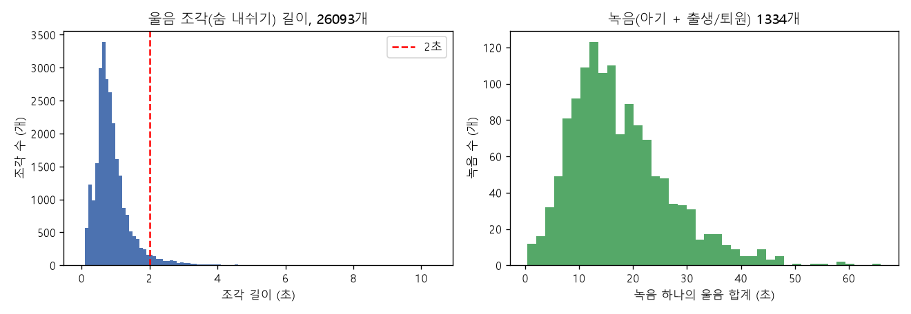

왼쪽: 울음 조각 길이 분포(초). 빨간 선이 2초. 오른쪽: 녹음 하나의 울음 합계(초).

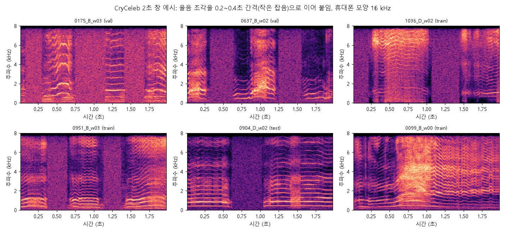

이어 붙인 2초 창 6개의 스펙트로그램(가로 시간 초, 세로 주파수 kHz). 울음 사이 간격이 작은 잡음으로 보인다.

### 아기 울음: AudioSet

- 평가 목록 60개 중 33개를 받았다. 27개는 영상이 삭제·비공개·차단되었다.
- 33개 중 높은 소리가 7 kHz 아래까지만 있는 6개를 뺐다 → 시험 27개.

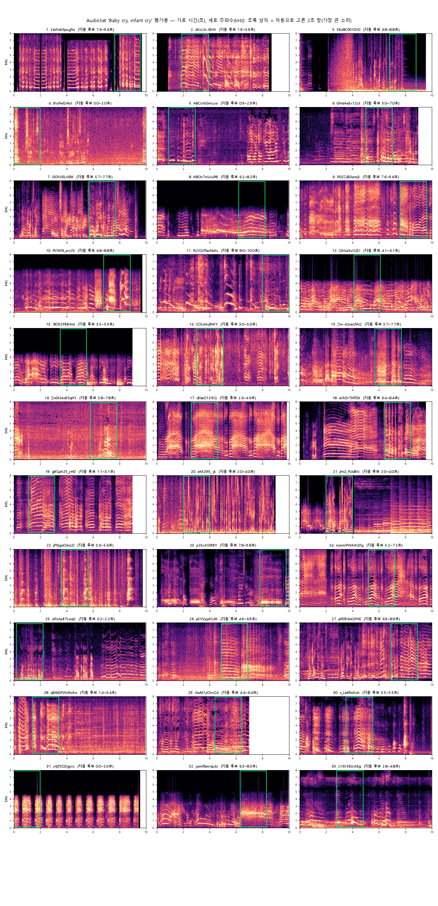

AudioSet 33개의 스펙트로그램. 초록 상자가 자동으로 고른 2초.

### 스피커 재녹음 도구 시험 (흉내 녹음)

첫 시험 (신호음 10 ms 단위)

| 확인 | 결과 |
| --- | --- |
| 잘라 낸 창 | 30 / 30개 |
| 정답 위치와의 차이 | 최대 8.7 ms, 평균 6.4 ms |
| 창 음량 − 앞 무음 음량 | 최소 21.2 dB (기준 10 dB) |

- 넣은 시계 차이 +40 ppm(122.5초 동안 4.9 ms)을 +0 ppm으로 쟀다. 10 ms 단위라 보이지 않았다.

시계 어긋남 보정 시험 (사이렌 시험 재생 파일 30개, 신호음 간격 122.5초)

| 넣은 시계 차이 | 끝 신호음 어긋남 | 고치기 전 잰 값 | 고치기 전 최대 오차 | 고친 뒤 잰 값 | 고친 뒤 최대 오차 |
| --- | --- | --- | --- | --- | --- |
| 0 ppm | 0.0 ms | +0 ppm | 4.0 ms | +0 ppm | 0.80 ms |
| +40 ppm | +4.9 ms | +82 ppm | 3.9 ms | +40 ppm | 0.86 ms |
| +300 ppm | +36.8 ms | +327 ppm | 3.9 ms | +300 ppm | 0.85 ms |
| −500 ppm | −61.2 ms | −490 ppm | 4.0 ms | −500 ppm | 0.85 ms |
| +1000 ppm | +122.5 ms | +980 ppm | 6.4 ms | +1000 ppm | 0.80 ms |

- ppm: 재생 1초가 녹음에서 1 + ppm × 10⁻⁶초가 된다는 뜻. 1,000 ppm = 0.1%.
- 흉내 녹음: 시계 차이 → 방 울림 → 0.3배 → 크롬 모양 16 kHz → 잡음 −55 dBFS.
### 실제 스피커 재녹음 (11/27)

- 노트북 스피커에서 휴대폰까지 1 m. 장소 칸은 desk지만 실제로는 침대 위에서 녹음(옆방 소음 배려).
- 재생 파일 6개를 웹 녹음 페이지로 녹음. 재생기가 반복 재생돼 끝 신호음 뒤에 처음부터 다시 나온 부분은 쓰지 않음.
- 녹음하는 동안 휴대폰에서 분할 화면으로 다른 앱을 썼다. 휴대폰이 바빠 소리 빠짐이 늘었을 수 있다(아래 원인 조사 참고).

| 녹음 | 재생 파일 | 소리 빠진 곳 | 쓴 창 | 무음 대비 (가운데값) | 일치도 (가운데값) |
| --- | --- | --- | --- | --- | --- |
| siren s01 | 사이렌 시험 | 1번 | 30 / 30 | 36.3 dB | 0.97 |
| horn s02 | 경적 시험 | 1번 + 시작 신호음 도중 | 30 / 30 | 31.9 dB | 0.96 |
| baby_cry s03 | 아기 울음 시험 | 8번 | 48 / 50 | 17.8 dB | 0.91 |
| siren s04 | 사이렌 검증 | 0번 | 25 / 25 | 19.0 dB | 0.96 |
| horn s05 | 경적 검증 | 1번 | 25 / 25 | 21.4 dB | 0.95 |
| baby_cry s06 | 아기 울음 검증 | 1번 | 25 / 25 | 21.5 dB | 0.93 |

- 뺀 창 2개: 아기 울음 시험 13, 14번(AudioSet). 원본과 음량 모양이 맞지 않음(일치도 0.70, 0.17).
- 무음 대비: 창 음량이 그 녹음의 무음 구간(가운데값)보다 몇 dB 큰지. 기준 10 dB.
- 일치도: 재생 파일과 녹음의 음량 곡선이 얼마나 비슷한지(1이면 같음).

**새로 발견한 문제: 휴대폰 녹음 중 소리가 빠짐**
- 녹음 안의 위치가 어느 순간 한 번에 약 40 ms씩 당겨진다. 녹음 중 소리 조각이 빠진 것이다.
- 3분 23초 녹음에서 8번, 1분 43초 녹음 3개 중 2개에서 1번, 1개는 0번.
- 시계 차이가 아니다: 소리가 안 빠진 녹음(siren s04)의 시계 차이는 −1 ppm.
- 재녹음은 창마다 위치를 따라가서 해결했다(아래 표). 직접 녹음과 실시간 알림에도 생기는지는 미확인.

원인 조사 (휴대폰, 3분씩, 조건마다 1번)

| 조건 | 블록 건너뜀 | 빈 입력 | 크롬 버림 | 벽시계 − 받은 소리 |
| --- | --- | --- | --- | --- |
| 막대 켬 · 밝기 자동 · 앱 없음 | 0 | 0 | 0 | 124.9 ms |
| 막대 끔 · 밝기 자동 · 앱 없음 | 0 | 0 | 0 | 33.8 ms |
| 막대 켬 · 밝기 최대 · 앱 없음 | 0 | 0 | 0 | 19.2 ms |
| 막대 켬 · 밝기 자동 · 유튜브 | 0 | 0 | 0 | 520.8 ms |

- 처음 의심한 코드(빈 입력 블록을 저장하지 않음)는 원인이 아니었다: 4번 모두 0번.
- 마이크는 3분 동안 실제 시간만큼 소리를 만들었고, 크롬도 모두 넘겨줬다고 기록했다.
- 그런데 크롬 소리 처리 시계는 실제 시간보다 조금씩 늦어졌다: 3분에 19~125 ms, 유튜브를 켜면 521 ms.
- 우리 코드가 받은 소리도 같은 만큼 짧았다(50 ms 단위로 150 / 50 / 50 / 500 ms).
- 결론(가장 그럴듯함): 크롬 소리 처리가 실제 시간을 못 따라가서, 넘친 마이크 소리를 크롬이 버린다. 휴대폰이 바쁠수록 많이 버린다.
- 음량 막대·밝기의 영향은 이 4번으로는 판단 못 한다(막대 켬 두 번이 125, 19 ms로 다름).

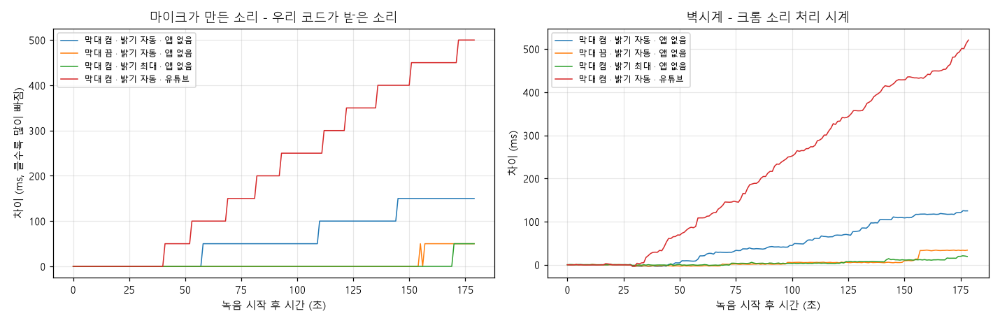

왼쪽: 마이크가 만든 소리 − 받은 소리(ms, 50 ms 조각 단위). 오른쪽: 벽시계 − 크롬 소리 처리 시계(ms). 가로는 녹음 시작 후 시간(초). 유튜브(빨강)가 가장 크게 벌어진다.

| 흉내 녹음 | 고치기 전 최대 오차 | 따라가기 후 최대 오차 | 평균 |
| --- | --- | --- | --- |
| 사이렌 30개, 빠짐 0 | 4.0 ms | 0.80 ms | 0.80 ms |
| 사이렌 30개, 50 ms 6번 빠짐 | 117.9 ms | 19.2 ms | 1.75 ms |
| 아기 울음 50개, 50 ms 8번 빠짐 | 127.7 ms | 11.7 ms | 2.32 ms |

- 최대 오차는 소리가 빠진 바로 그 창(창 안에서 빠짐)에서 난다.
- 한계: 따라가기는 시계 차이가 거의 없다고 가정한다. 시계 차이 −400 ppm에 소리 빠짐까지 겹치면 오차 55 ms(흉내 시험). 이 휴대폰·PC에서는 −1 ppm이라 해당 없음.

## 4. 발견한 문제와 해결

| 문제 | 원인 | 해결 |
| --- | --- | --- |
| 첫 배포 실패 | push 때 저장소 Pages 설정이 꺼져 있었다 | Pages 설정(Source: GitHub Actions) 후 다시 실행 → 성공 |
| 가까운 박수가 잘림 직전 (−0.3 dBFS) | 휴대폰 바로 앞에서 손뼉 | 녹음 때 화면의 클리핑 경고를 보고 거리를 띄운다 |
| 녹음 끝 최대 50 ms 빠짐 | 소리를 800개(50 ms) 묶음으로 받는다 | 회차 녹음(수십 초~수 분)에는 영향이 작아 그대로 둔다 |
| 첫 실제 회차에서 15개·17개를 찾음 (기대 10개) | 혼자 녹음해서 나가고 들어오는 발소리·문소리가 앞뒤에 들어감 | 앞뒤 잘라 내기 옵션 추가 (`--skip-start`, `--skip-end`) → 초인종 10개 |
| 노크 회차에서 작은 잡음 2개를 노크로 셈 | 노크와 크기 차이가 2~3 dB뿐 (잡음 +24.4 dB, 가장 작은 노크 +27.6 dB) | 그림을 보고 번호로 제외하는 옵션 추가 (`--drop`) → 10개 |
| 시험 페이지 배포 실패 (2번 다시 실행해도 같음) | GitHub 배포 도구 버그: 올리기와 배포가 같은 작업에 있으면 방금 올린 파일을 못 찾음 | 올리기·배포를 두 작업으로 나눔 → 성공 |
| WebGPU 결과가 PyTorch와 다름 (최대 1.79e-02) | 미확인 (GPU 계산 정밀도 차이로 추정) | 기본은 wasm으로 쓰고 WebGPU는 쓰지 않음. 고치지 않고 보고함 |
| 실시간 확률 막대가 빈 칸 | 화면 코드(CSS) 실수 | 고침. 숫자와 측정에는 영향 없음 |
| 작은 초인종 구간이 일찍 끝남 (합성 4번 2.58초, 큰 소리 4.58초) | 울림 끝이 배경 수준 가까이 작아져 꺼짐 기준 아래로 내려감 | 2단계에서 처리: 소리 끝 1초 안은 '그 외'로 쓰지 않음 |
| 나가기·들어오기 소리를 잘라 버림 (1단계-2) | 발소리·문소리는 노크와 헷갈리기 쉬운 귀한 '그 외' | 버리지 않고 같은 회차의 '그 외'로 남김 (`--other-until`, `--other-from`) |
| 공개 데이터와 휴대폰 녹음의 높은 소리 모양이 다름 | 크롬 변환은 6~8 kHz를 줄이고 soxr는 평평함 | 크롬 모양 필터. 처음 방식(16 kHz에서 필터)은 7.5~8 kHz를 못 맞춤 → 48 kHz에서 필터 후 16 kHz로 |
| 크롬 측정 결과가 들쭉날쭉 | 측정용 잡음 생성 코드(JS) 계산이 숫자 한계를 넘어 잡음이 고르지 않음 | `Math.random`으로 바꿔 다시 측정 |
| AI Hub 분할 1차: 사이렌·경적 시험이 묶음 1개뿐 | 파일 수 비율만 맞춤 | 묶음 수 비율도 함께 맞춤 |
| 경적 시험 308개 중 292개가 이륜차 경적 (차량경적 AI Hub 8개) | 차량경적은 시험에 들어간 묶음이 작음 | 차량경적만 든 묶음 1개를 시험으로 옮기고 시험을 차량 30 · 이륜차 30으로 맞춤 |
| 이륜차경적 시험 30개가 묶음 1개(고양시 용두동 11/12) | AI Hub 이륜차경적은 거의 용두동에서 녹음. 같은 장소의 다른 날짜 묶음 4개가 학습에 있음 | 아직 못 함. 한계로 기록 (날짜가 달라 분할 검사는 통과) |
| 재녹음 시계 어긋남을 못 잼 (+40 ppm → +0 ppm) | 신호음을 10 ms 단위로 찾음 | 1 kHz 크기 곡선에서 샘플 단위로 찾음 → 잰 값 오차 0 ppm, 위치 오차 0.86 ms 이하 |
| 샘플 단위로 바꾼 첫 시험에서 신호음 시작이 16.7 ms 늦게 잡힘 | 절반 높이 기준: 방 울림이 쌓이는 동안 늦어짐 | 기준을 안정된 크기의 10%로 낮춤 |
| 휴대폰 측정 기능의 값이 측정마다 0.9 dB 흔들림 (PC) | 잡음 4초를 반복 재생 → 서로 다른 잡음이 4초뿐 | 반복 없이 21초 잡음, 옆 5칸 평균으로 읽음 → 흔들림 0.3 dB 안쪽 |
| AudioSet 60개 중 33개만 받음 | 영상 삭제·비공개·차단 27개 | 설계서 8절 대안: CryCeleb 다른 아기와 ESC-50 울음을 시험에 더함 |
| AudioSet 6개가 저음질 (높은 소리 4.5~6.8 kHz까지) | 원래 영상 음질 | 시험에서 뺌 (1주차 저음질 지름길 방지) |
| CryCeleb 시험 부분은 같은 아기에 ID 두 개 | 출생·퇴원 녹음에 서로 다른 익명 ID | CryCeleb train·dev 부분만 씀 (아기 626명) |
| FSD50K 노크 270개 중 94개가 2초 미만 | 짧은 노크 클립 | AI Hub와 같이 2초 미만은 뺌 → 176개 |
| 학습 사이렌·경적이 상한 600을 넘음 (624개) | 처음엔 '그 외'만 상한 적용 | 클래스마다 상한 적용 |
| 실제 재녹음에서 녹음 위치가 한 번에 약 40 ms씩 당겨짐 (파일마다 0~8번) | 휴대폰 녹음 중 소리 조각이 빠짐. 조사 결과: 크롬 소리 처리 시계가 실제 시간보다 늦어져 넘친 마이크 소리를 크롬이 버림(휴대폰이 바쁠수록 많음) | 재녹음은 창마다 빠진 곳을 찾아 보정(−280.0 vs −279.1 ms). 받는 방식은 바꾸지 않고 한계로 기록(사용자 결정 11/27) |
| 경적 시험 녹음: 시작 신호음 도중에 소리가 빠져 첫 창부터 78 ms 어긋남 | 시작 신호음 정밀 찾기 실패 | 첫 구간이 20 ms 넘게 어긋나면 맞춰 본 위치를 씀 → 일치도 가운데값 0.87 → 0.96 |
| 멀쩡한 재녹음 창 6개가 '너무 작음'으로 빠짐 | 바로 앞 무음 구간에 생활 소음이 들어감 | 그 녹음의 무음 구간 가운데값과 비교 → 뺀 창 8개 → 2개 |
| 재녹음 창 위치를 음량 곡선으로 다시 잡았더니 최대 300 ms 어긋남 | 사이렌처럼 일정한 소리는 곡선이 비슷해 위치를 잘못 고름 | 시작·끝 신호음으로만 맞춤 → 최대 8.7 ms (이후 샘플 단위로 고쳐 0.86 ms) |

## 5. 결정과 이유

| 결정 | 이유 |
| --- | --- |
| 1주차 코드·데이터를 쓰지 않고 새로 시작 | 노트북 경로 결과는 휴대폰 성능을 증명하지 못한다 |
| 기본 녹음 앱 대신 웹앱 녹음 모드 | 기본 녹음 앱은 소리 처리가 달라 실제 입력과 달라진다 |
| `web/` 폴더만 배포 (GitHub Actions) | 학습 코드와 문서는 휴대폰에 필요 없다 |
| 같은 이름 재저장 시 `_t2`, `_t3` 붙임 | 회차 앞뒤 배경 녹음 두 개가 같은 이름이 된다. 회차 ID는 그대로 둔다 |
| 장소 이름에 밑줄 금지 | 파일 이름을 `_`로 다시 나눌 수 있게 |
| 모델 실행은 wasm (WebAssembly), WebGPU 파일은 뺌 | 휴대폰에서 결과 일치, 8.87 ms로 충분히 빠름. WebGPU는 결과가 다르고 빠르지 않음 |
| onnxruntime-web을 사이트에 함께 넣음 (CDN 안 씀) | 나중에 비행기 모드(오프라인)에서도 돌아야 함 |
| STFT를 합성곱으로 구현 | 브라우저에서 확실히 도는 기본 연산만 쓰기 위해 (설계서 8절 대안을 처음부터 적용) |
| 이륜차 경적 → 경적, 차량·이륜차 주행음 → 그 외 | 집 안에서 들리는 경적은 차량·이륜차 모두 알려야 함. 주행음은 알릴 소리가 아님 |
| AI Hub 묶음 = 녹음 날짜 + 시 + 구 | 같은 날 같은 곳 녹음은 배경이 같아 한 분할에 둬야 함 |
| 공개 데이터에 크롬 모양 필터 | 높은 소리 모양이 출처를 알려 주는 지름길이 되지 않게 |
| 2초 미만 조각은 뺌 (AI Hub, FSD50K) | 2초를 채우려면 다른 소리를 덧대야 함 |
| AudioSet 창은 자동(가장 큰 2초) | 사용자 결정. 저음질 6개만 뺌 |
| CryCeleb 조각을 0.2~0.4초 간격으로 이어 붙임 | 실제 울음처럼 "울음, 숨, 울음"이 2초 안에 들어가게 |
| CryCeleb 상한: 학습 600, 검증·시험 150 | 가능한 창은 약 1만 개. 다른 클래스와 개수를 맞춤 |
| FSD50K는 개발용(18.4 GB)만 받음 | 노크 270개가 개발용에 있음. 평가용은 받지 않음 |
| 회차 정보 파일 이름 `meta.csv` → `sessions.csv` | `meta.csv`는 모든 출처를 모은 2초 창 표로 씀 |
| 경적 시험 60개, 차량 30 · 이륜차 30 | 경적 점수가 한쪽 경적 점수가 되지 않게. 재녹음 30개로 다 틀 수 있는 크기 |
| 차량경적 묶음을 시험으로 옮김 (시험 비율 15% 넘어도) | 차량경적 시험 묶음이 작아 시험 개수를 먼저 채움. 같은 장소의 다른 날짜가 학습에 없는 묶음만 |
| meta.csv에 `subclass`, `orig_source` 칸 | 경적은 차량/이륜차, 아기 울음은 출처별로 점수를 나눠 볼 수 있게 |
| 아기 울음 재녹음 시험: AudioSet → ESC-50 → CryCeleb 순서 | 실제 영상 소리를 먼저. CryCeleb는 이어 붙인 소리라 모자란 만큼만 |
| 휴대폰 크롬 변환 모양을 직접 잼 | 공개 데이터 필터가 PC 측정 기반. 휴대폰이 다르면 필터가 지름길을 만들 수 있음 |
| 직접 녹음 s01, s02는 학습 | 사용자 결정 |
| 재녹음 신호음 시작을 샘플 단위, 10% 높이로 찾음 | 수 ms 시계 어긋남까지 보정. 방 울림에 늦게 잡히지 않게 |
| 재녹음 검증 개수 25개, 경적 재녹음도 차량·이륜차 반씩 | 문서 20~30 중 가운데. 시험과 같은 기준 |
| 재녹음에서 맞지 않는 창은 빼고 다시 녹음하지 않음 | 사용자 요청. 183 / 185개 사용 |
| 소리 빠짐은 고치지 않고 한계로 기록 | 평소 3분에 0.1초 안팎(2초 창에서 가끔 약 40 ms). 받는 방식을 바꾸면 크롬 모양 필터·휴대폰 측정·재녹음을 다시 해야 함. 12/3 일정 |
| AI Hub 고르기 난수를 (분할, 클래스)마다 따로 | 경적 시험을 바꿔도 다른 칸이 덜 바뀌게. 이번 변경으로 AI Hub 창을 모두 다시 만듦(3,681 → 3,431개) |

설계서와 달라진 점

- CryCeleb: 설계서는 신생아 786명. 실제로는 train·dev 부분 아기 626명만 쓴다(시험 부분은 아기 ID를 믿을 수 없음).
- AudioSet: 목표 50개에 못 미쳐(27개) 설계서 8절 대안을 썼다. CryCeleb는 학습과 시험 출처가 겹친다(아기는 다름).
- 분할 비율: AI Hub 경적 조각의 시험 비율이 23.4%로 목표 15%를 넘는다(학습 59.0 · 검증 17.7 · 시험 23.4%).

## 6. 다음 주 계획

이번 주 남은 일 (설계서 7절)

- 2단계: 초인종 검증·시험과 시험 A의 초인종·노크·그 외는 직접 녹음 회차가 더 필요 (s01, s02는 학습)
- 한계로 기록: 휴대폰 녹음 중 소리 빠짐(크롬 처리 시계 지연). 실시간 알림에 미치는 영향은 5단계 앱 동작 시험에서 함께 본다
- 3단계: 기준 모델 v1 학습과 휴대폰 시험셋 점수

3주차 (12/4~10)

- 4단계: 개선 실험 (배경 소음 섞기, 스피커 재녹음 등)

## 핵심 숫자

| 숫자 | 값 | 출처 파일 |
| --- | --- | --- |
| 1주차 공개 데이터 시험 macro-F1 | 0.84 | `CLAUDE.md` (1주차 결과) |
| 1주차 저음질 '그 외' → 아기 울음 판단 비율 | 82% | `CLAUDE.md` (1주차 결과) |
| 1주차 환풍기 구간 → 초인종 판단 | 40번 중 16번 | `CLAUDE.md` (1주차 결과) |
| 1주차 노크·원래 음질 아기 울음 시험 개수 | 8개 | `CLAUDE.md` (1주차 결과) |
| 통화용 처리 3가지 실제 값 | 모두 false | `docs/figures/phone_settings_1126.png` |
| 휴대폰 마이크 샘플레이트 | 48000 Hz | `docs/figures/phone_settings_1126.png` |
| 휴대폰 크롬 버전 | 158.0.8127.42 | `docs/figures/phone_settings_1126.png` |
| 확인 녹음 길이 | 11.20초 (179200 샘플) | `docs/logs/check_recording_1126.txt` |
| 확인 녹음 최댓값 | 31549 / 32768 (−0.3 dBFS) | `docs/logs/check_recording_1126.txt` |
| 확인 녹음 잘린 샘플 | 0개 | `docs/logs/check_recording_1126.txt` |
| 4~7.8 kHz 세기 바닥 → 최대 | −85.7 → −23.8 dB (61.9 dB 차이) | `docs/logs/check_recording_1126.txt` |
| JS 변환 7000 Hz 세기 | −2.6 dB (48 kHz 입력) | `docs/logs/resample_test_1126.txt` |
| JS 변환 9000 Hz 접힘 성분 | −87.7 dB (48 kHz 입력) | `docs/logs/resample_test_1126.txt` |
| PC 크롬 4초 녹음 샘플 수 | 64000 (4.00초) | `docs/logs/e2e_chrome_1126.txt` |
| 합성 초인종 회차 찾은 구간 | 10개 / 기대 10개 | `docs/logs/session_check_synth_1126.txt` |
| 합성 노크 회차 찾은 구간 | 10개 / 기대 10개 | `docs/logs/session_check_synth_1126.txt` |
| 합성 초인종 가장 작은 소리 | 배경보다 +17.9 dB | `docs/logs/session_check_synth_1126.txt` |
| 실제 초인종 회차 찾은 구간 (자르기 전 → 후) | 15개 → 10개 | `docs/logs/session_check_real_1126.txt` |
| 실제 노크 회차 찾은 구간 (자르기 전 → 자르기 후 → 잡음 제외 후) | 17개 → 12개 → 10개 | `docs/logs/session_check_real_1126.txt` |
| 실제 초인종 한 번 길이 | 4.27~4.32초 | `docs/logs/session_check_real_1126.txt` |
| 모델 파일 크기 | 6,812,310 바이트 (6.81 MB) | `docs/logs/onnx_export_1126.txt` |
| 모델 파라미터 | 1,524,006개 | `docs/logs/onnx_export_1126.txt` |
| 로그 멜 모양 | 64 × 201 | `docs/logs/onnx_export_1126.txt` |
| Python onnxruntime vs PyTorch 최대 차이 | 2.38e-05 | `docs/logs/onnx_export_1126.txt` |
| 휴대폰 wasm vs PyTorch 최대 차이 | 1.96e-05 (4개 통과) | `docs/logs/model_test_phone_wasm_1126.json` |
| 휴대폰 wasm 1회 평균 / p95 | 8.87 / 9.3 ms | `docs/logs/model_test_phone_wasm_1126.json` |
| 휴대폰 wasm 첫 실행 | 40 ms | `docs/logs/model_test_phone_wasm_1126.json` |
| 휴대폰 실시간 실행 | 32번, 평균 21.68 ms, 건너뜀 0번 | `docs/logs/model_test_phone_wasm_1126.json` |
| 휴대폰 WebGPU vs PyTorch 최대 차이 | 1.79e-02 (3개 실패) | `docs/logs/model_test_phone_webgpu_1126.json` |
| 휴대폰 WebGPU 1회 평균 / p95 | 9.32 / 12.6 ms | `docs/logs/model_test_phone_webgpu_1126.json` |
| 크롬 48k→16k −1 / −3 / −6 dB 지점 | 6,375 / 6,922 / 7,359 Hz | `docs/logs/resample_compare_1127.txt` |
| soxr 48k→16k −1 dB 지점 | 7,562 Hz | `docs/logs/resample_compare_1127.txt` |
| 크롬 모양 필터 후 크롬과 평균 차이 (6.0~7.5 kHz, 48 kHz 입력) | 0.04 dB (필터 전 2.47 dB) | `docs/logs/chrome_filter_verify_1127.txt` |
| 크롬 모양 필터 후 크롬과 평균 차이 최대 (0.5~7.8 kHz) | 0.55 dB (44.1 kHz 입력, 7.5~7.8 kHz) | `docs/logs/chrome_filter_verify_1127.txt` |
| AI Hub 2초 창 (경적 시험 수정 후) | 3,431개 (조용해서 뺀 것 28개) | `docs/logs/aihub_extract_1127b.txt` |
| AI Hub 묶음 | 385개, 여러 분할에 걸친 묶음 0개 | `docs/logs/aihub_index_1127.txt` |
| AI Hub 차량경적 시험 창 (수정 전 → 후) | 8개 → 22개 | `docs/logs/aihub_extract_1127.txt`, `docs/logs/aihub_extract_1127b.txt` |
| 시험으로 옮긴 차량경적 묶음 | 양주시 도하리 2021-10-26, 조각 332개 | `docs/logs/aihub_override_1127.txt` |
| AI Hub 경적 조각 분할 비율 | 학습 59.0 / 검증 17.7 / 시험 23.4% | `docs/logs/aihub_override_1127.txt` |
| 경적 시험 소분류 | 차량경적 22 (5묶음), car_horn 8 (6묶음), 이륜차경적 30 (1묶음) | `docs/logs/horn_test_groups_1127.txt` |
| ESC-50 2초 창 | 1,998개 (묶음 1,524개) | `docs/logs/esc50_windows_1127.txt` |
| AudioSet 받기 성공 | 33 / 60 | `docs/logs/audioset_download_1127.txt` |
| AudioSet 저음질(7 kHz 미만) 제외 | 6개 | `docs/logs/audioset_bandwidth_1127.txt` |
| FSD50K 노크 → 2초 창 | 270개 → 176개 (2초 미만 94개) | `docs/logs/fsd50k_windows_1127.txt` |
| FSD50K 노크 분할 | 학습 119 / 검증 27 / 시험 30 | `docs/logs/fsd50k_windows_1127.txt` |
| CryCeleb 파일 / 합계 | 26,093개 / 6.51시간 | `docs/logs/cryceleb_summary_1127.txt` |
| CryCeleb 조각 길이 중앙값 / 2초 이상 | 0.78초 / 4.3% | `docs/logs/cryceleb_summary_1127.txt` |
| CryCeleb 대역폭 최소 | 7.8 kHz | `docs/logs/cryceleb_summary_1127.txt` |
| CryCeleb 쓴 아기 분할 | 학습 438 / 검증 94 / 시험 94명 | `docs/logs/cryceleb_windows_1127.txt` |
| CryCeleb 고른 창 | 학습 600 / 검증 150 / 시험 150 | `docs/logs/cryceleb_windows_1127.txt` |
| 직접 녹음 회차 확인 (나가기·들어오기를 '그 외'로) | 노크 10 / 10 | `docs/logs/session_check_real_1127.txt` |
| meta.csv 전체 | 6,403줄, 묶음 2,629개, 여러 분할에 걸친 묶음 0개 | `docs/logs/check_splits_1127d.txt` |
| 시험 개수 (노크 / 아기 울음 / 사이렌 / 경적) | 38 / 185 / 65 / 60 | `docs/logs/check_splits_1127d.txt` |
| 아기 울음 시험 출처 | AudioSet 27, ESC-50 8, CryCeleb 150 | `docs/logs/check_splits_1127d.txt` |
| 아기 울음 재녹음 시험 재생 파일 | 50개 = AudioSet 27 + ESC-50 8 + CryCeleb 15 | `docs/logs/playlist_baby_cry_test_1127.txt` |
| 재녹음 도구 흉내 시험 위치 차이 (첫 시험) | 최대 8.7 ms, 평균 6.4 ms (30개) | `docs/logs/rerecord_sim_1127.txt` |
| 재녹음 시계 보정 시험 (−500~+1000 ppm) | 잰 ppm 오차 0, 위치 오차 최대 0.86 ms | `docs/logs/rerecord_drift_1127.txt` |
| 휴대폰 측정 기능 PC 재측정 vs 예전 PC 측정 | 구간별 평균 차이 최대 0.17 dB | `docs/logs/resampler_page_pc_1127.txt` |
| 휴대폰 크롬 −1 / −3 / −6 dB 지점 | 6,547 / 6,969 / 7,375 Hz | `docs/logs/phone_resampler_1127.txt` |
| 휴대폰 − PC 크롬 변환 구간별 평균 차이 최대 (0.5~7.8 kHz) | 0.10 dB | `docs/logs/phone_resampler_1127.txt` |
| 스피커 재녹음 쓴 창 | 183 / 185개 (뺀 것: 아기 울음 시험 13, 14번) | `docs/logs/rerecord_align_1127.txt` |
| 재녹음 창 구성 | 시험: 사이렌 30, 경적 30, 아기 울음 48 / 검증: 각 25 | `docs/logs/rerecord_counts_1127.txt` |
| 아기 울음 재녹음 시험 출처 | AudioSet 25, ESC-50 8, CryCeleb 15 | `docs/logs/rerecord_counts_1127.txt` |
| 휴대폰 녹음 소리 빠진 곳 (s01~s06) | 1, 1(+시작 신호음 도중), 8, 0, 1, 1번. 한 번에 약 40 ms | `docs/logs/rerecord_align_1127.txt` |
| 소리 안 빠진 녹음의 시계 차이 | −1 ppm (siren s04) | `docs/logs/rerecord_align_1127.txt` |
| 소리 빠짐 조건 시험 (3분 × 4): 빈 입력·블록 건너뜀·크롬 버림 | 모두 0 | `docs/logs/dropout_test_phone_1127.json` |
| 소리 빠짐 조건 시험: 벽시계 − 받은 소리 | 124.9 / 33.8 / 19.2 / 520.8 ms (유튜브) | `docs/logs/dropout_test_phone_1127.json` |
| 크롬 처리 시계 지연 기울기 (막대 켬 / 끔 / 밝기 최대 / 유튜브) | 828 / 159 / 90 / 3,223 ppm | `docs/logs/dropout_analysis_1127.txt` |
| 마이크가 만든 소리 − 받은 소리 (3분) | 150 / 50 / 50 / 500 ms | `docs/logs/dropout_analysis_1127.txt` |
| 따라가기 흉내 시험 (50 ms 6번 빠짐) | 고치기 전 최대 117.9 ms → 후 최대 19.2 ms, 평균 1.75 ms | `docs/logs/rerecord_track_sim_1127.txt` |
| meta.csv 전체 (재녹음 포함) | 6,586줄, 여러 분할에 걸친 묶음 0개 | `docs/logs/check_splits_1127e.txt` |

## 예상 질문과 답

**Q. 왜 앱이 아니라 웹앱인가?**
3주 안에 완성할 수 있고 링크 하나로 설치된다. 화면이 꺼지면 멈추는 점은 한계로 밝힌다.

**Q. 통화용 처리를 왜 끄나?**
통화용 처리는 사람 목소리만 남기려고 다른 소리를 깎는다. 초인종·노크가 깎일 수 있다.

**Q. 크롬이 끄기 요청을 무시하면?**
`getSettings()`로 실제 값을 확인했고 셋 다 false였다. 학습 데이터도 같은 경로로 모으므로 학습과 사용이 일치한다.

**Q. 왜 16 kHz인가? 높은 소리가 사라지지 않나?**
16 kHz는 8 kHz까지 담는다. 확인 녹음에서 4~8 kHz 소리가 남는 것을 스펙트로그램으로 확인했다.

**Q. 삼성 기본 녹음 앱으로 녹음하면 안 되나?**
기본 녹음 앱은 소리 처리가 달라 실제 사용할 때 들어오는 소리와 달라진다.

**Q. 16 kHz 변환이 정확한지 어떻게 아나?**
휴대폰은 크롬 내장 변환을 쓰고, 확인 녹음 스펙트로그램으로 확인했다. 예비 JS 변환은 사인파로 6 kHz까지 0.0 dB임을 확인했다.

**Q. 데이터는 왜 저장소에 안 올리나?**
공개 데이터 이용 조건(비상업용, 배포 금지) 때문이다. 모델 파일만 배포한다.

**Q. 소리 구간은 사람이 직접 표시하나?**
아니다. 배경보다 확실히 커진 구간을 스크립트가 찾고, 누른 횟수와 개수가 같은지만 사람이 확인한다.

**Q. 자동 구간 찾기가 맞는지 어떻게 아나?**
합성 회차와 첫 실제 회차(초인종·노크 각 10번)에서 10개를 찾았다. 실제 회차는 앞뒤 잡음을 잘라 내고, 노크 회차의 작은 잡음 2개는 그림을 보고 제외했다.

**Q. 휴대폰에서 모델이 정말 돌아가나?**
돈다. 갤럭시 S24 Ultra 크롬에서 1회 평균 8.87 ms. 기준 100 ms의 약 9%다.

**Q. 휴대폰 결과가 PC 학습 결과와 같다는 걸 어떻게 아나?**
같은 입력 4개를 넣어 PyTorch와 비교했다. 최대 차이 1.96e-05로 기준 0.001보다 훨씬 작다.

**Q. 왜 전처리를 모델 안에 넣었나?**
학습과 휴대폰이 같은 계산을 하게 하려고. 따로 구현하면 작은 차이로 정확도가 떨어질 수 있다.

**Q. GPU(WebGPU)를 쓰면 더 빠르지 않나?**
휴대폰에서 재 보니 평균 9.32 ms로 wasm(8.87 ms)과 비슷했고, 결과가 PyTorch와 달랐다. 그래서 wasm을 쓴다.

**Q. 임시 모델인데 의미가 있나?**
이번에 확인한 건 정확도가 아니라 "돌아가는가, 같은 값인가, 빠른가"다. 학습한 모델도 구조가 같아서 속도는 같다.

**Q. 공개 데이터에 왜 일부러 필터를 씌우나?**
휴대폰 크롬은 6~8 kHz를 줄인다. 공개 데이터만 높은 소리가 많으면 모델이 소리 대신 "출처"를 외울 수 있다. 1주차 저음질 지름길과 같은 문제다.

**Q. PC 크롬으로 잰 모양이 휴대폰 크롬과 같은가?**
같다. 휴대폰에서 같은 방식(48 kHz 백색 잡음 → 16 kHz)으로 쟀고, 구간별 평균 차이가 최대 0.10 dB였다.

**Q. CryCeleb 조각을 이어 붙이면 진짜 울음과 다르지 않나?**
다르다. 숨 들이쉬는 소리가 없고 간격은 잡음으로 채웠다. 그래서 시험의 주 데이터는 AudioSet(실제 영상)이고, 4단계에서 출처별 재현율을 따로 본다.

**Q. 같은 아기가 학습과 시험에 들어가지 않나?**
아기 ID 단위로 나눴다. ID를 믿을 수 없는 CryCeleb 시험 부분은 쓰지 않았다.

**Q. 경적 시험은 어떻게 구성했나?**
60개, 차량 30(AI Hub 22 + ESC-50 8)과 이륜차 30. 점수를 차량/이륜차로 나눠서도 낸다.

**Q. 경적 시험 비율이 15%를 넘는데?**
차량경적은 시험 묶음이 작아 학습 묶음 하나를 시험으로 옮겼다. 시험 개수를 비율보다 먼저 챙겼다.

**Q. 이륜차경적 시험이 한 장소뿐인데?**
한계다. AI Hub 이륜차경적은 거의 한 동네(고양시 용두동)에서 녹음됐다. 날짜는 학습과 다르다.

**Q. 아기 울음 점수는 어느 출처에서 나온 건가?**
출처별(AudioSet, ESC-50, CryCeleb)로 따로 낸다. CryCeleb는 이어 붙인 소리라 따로 봐야 한다.

**Q. 재녹음 때 PC와 휴대폰 시계가 다르면?**
앞뒤 신호음 사이 길이로 맞춘다. 실제로 재 보니 시계 차이는 −1 ppm으로 거의 없었다.

**Q. 재녹음 파일을 어떻게 원본과 맞췄나?**
앞뒤 신호음으로 시작을 잡고, 녹음 중 소리가 빠진 곳은 창마다 음량 곡선을 맞춰 찾았다. 빠진 양 합계가 끝 신호음 차이와 맞았다(−280.0 vs −279.1 ms).

**Q. 휴대폰 녹음에서 소리가 빠지면 실시간 알림에도 문제 아닌가?**
원인은 크롬 소리 처리 시계가 실제 시간보다 늦어지는 것이다. 평소 3분에 0.1초 안팎이라 2초 창에서는 가끔 약 40 ms가 빠진다. 판단에는 영향이 작을 것으로 보고 한계로 기록했다. 휴대폰이 바쁘면(유튜브) 3분에 0.5초까지 늘어난다.
