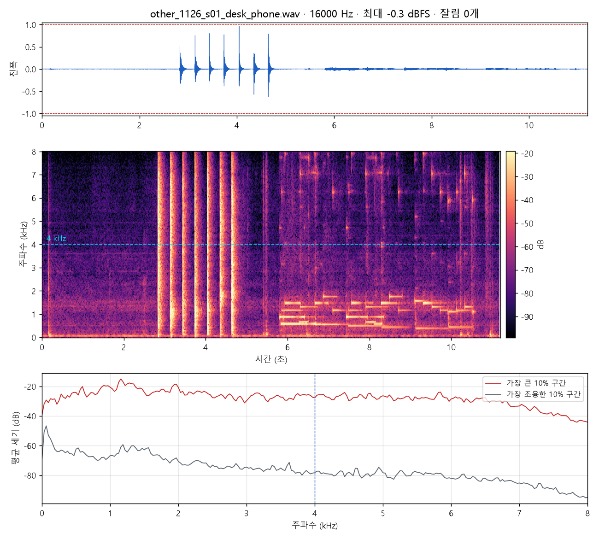

# 녹음 설정 (recording_setup)

앞으로 모든 직접 녹음과 앱 시험은 이 설정을 따른다. 기기, 브라우저 버전, 마이크 설정이 바뀌면 여기에 새 줄을 더하고 날짜를 적는다.

> 상태: **확정 (2026-11-26)**. 휴대폰 확인 1~4 통과. 6절(위치·볼륨)은 녹음을 시작하면 채운다.

## 1. 기기와 브라우저

| 항목 | 값 | 확인 방법 |
| --- | --- | --- |
| 휴대폰 | 갤럭시 S24 Ultra (SM-S928N) | 녹음 페이지 '기종' 칸 |
| 안드로이드 | 16.0.0 | 녹음 페이지 'OS' 칸 |
| 크롬 | 158.0.8127.42 | 녹음 페이지 'Chrome' 칸 |
| 페이지 주소 | https://munpin.github.io/sound-alert/ | 저장소 https://github.com/Munpin/sound-alert |

## 2. 마이크 설정

`getUserMedia`에 요청한 값과 실제로 적용된 값(`track.getSettings()`).

| 항목 | 요청 | 실제 (휴대폰) |
| --- | --- | --- |
| echoCancellation (에코 제거) | false | **false** |
| noiseSuppression (잡음 제거) | false | **false** |
| autoGainControl (자동 음량) | false | **false** |
| channelCount (채널 수) | 1 | 1 |
| sampleRate (마이크 샘플레이트) | 요청 안 함 | 48000 Hz |
| 마이크 이름 (track.label) | | 기본값 |

- 세 가지 처리 중 하나라도 `true`면 설계서 8절 위험에 해당한다. 그래도 학습 데이터를 같은 경로로 모으므로 학습과 사용은 일치하고, 한계로 기록한다.
- 채널 수가 2로 나와도 저장되는 소리는 모노다. AudioWorklet 앞에서 브라우저가 두 채널을 평균 내 한 채널로 섞는다(`channelCountMode: 'explicit'`, `channelCount: 1`).

## 3. 16 kHz 변환

| 항목 | 값 |
| --- | --- |
| 쓰는 방식 (휴대폰) | **브라우저 변환** (AudioContext 16000 Hz, 마이크 48 kHz → 크롬이 16 kHz로 변환) |
| 방식 1: 브라우저 변환 | `new AudioContext({ sampleRate: 16000 })`. 크롬이 마이크 신호를 16 kHz로 바꿔 준다. 이게 되면 이걸 쓴다. |
| 방식 2: JavaScript 변환 | 방식 1이 안 될 때만 쓴다. 원래 샘플레이트(보통 48 kHz)로 받아 AudioWorklet 안에서 윈도 싱크 보간으로 바꾼다. 차단 7.2 kHz, Kaiser 창(β=8), 반쪽 길이 24×(입력/출력 비) |
| 저장 형식 | wav, 16000 Hz, 모노, 16비트 PCM. 저장할 때 다시 변환하지 않는다. |
| 시험용 주소 | 주소 끝에 `?resample=js`를 붙이면 방식 2를 강제로 쓴다. |

방식 2의 PC 시험 결과(Node, 사인파 넣기): 48 kHz 입력 기준 6 kHz까지 0 dB, 7 kHz −2.6 dB, 7.6 kHz −21 dB. 8 kHz 위 소리가 접혀 들어오는 성분(앨리어싱)은 −87 dB 이하.

## 3-1. 모델 실행 (onnxruntime-web)

| 항목 | 값 |
| --- | --- |
| onnxruntime-web | **1.31.1** (npm, MIT). `web/vendor/`에 넣어 씀 (인터넷 CDN 안 씀, 나중 오프라인 동작용) |
| 기본 백엔드 | wasm (WebAssembly): `ort.wasm.min.mjs` + `ort-wasm-simd-threaded.{mjs,wasm}` |
| WebGPU | 2026-11-26 휴대폰 비교 후 파일을 뺌 (결과 불일치, 속도 이점 없음). 필요하면 git 기록에서 되살림 |
| 스레드 | GitHub Pages는 crossOriginIsolated가 아니라 wasm 멀티스레드를 못 씀 → 1스레드 |
| 시험 페이지 | https://munpin.github.io/sound-alert/model-test.html |
| 휴대폰 결과 (S24 Ultra, 2026-11-26) | **wasm 사용.** 고정 입력 4개 통과(최대 차이 1.96e-05), 평균 8.87 ms, p95 9.3 ms (`docs/logs/model_test_phone_wasm_1126.json`) |
| WebGPU (비교용) | 고정 입력 4개 중 3개 실패(최대 차이 1.79e-02), 평균 9.32 ms → 쓰지 않음 (`docs/logs/model_test_phone_webgpu_1126.json`) |

## 4. 파일 이름과 메타데이터

- 파일 이름: `클래스_날짜_회차_장소_기기.wav` (예: `doorbell_1126_s01_desk_phone.wav`)
  - 같은 이름을 또 저장하면 끝에 `_t2`, `_t3`이 붙는다(예: 회차 앞뒤의 배경 녹음 두 개).
  - 장소는 영문 소문자·숫자만 쓴다(밑줄 없이). 파일 이름을 `_`로 다시 나눌 수 있게 하기 위해서다.
- 회차 ID(`group_id`): `phone_MMDD_sNN`. 학습·검증·시험 분할 단위다.
- `data/meta.csv` 머리글: `file,class,source,group_id,split,place,background,phone_state,device,date,license,note`
  - 직접 녹음: `source=own`, `license=own`, `device=phone`, `split`은 비워 둔다.
  - 녹음 페이지 5번 칸 '전체 복사'로 그날 저장한 줄을 한 번에 옮길 수 있다.
  - (2026-11-27 바뀜) 녹음 페이지가 만든 줄은 `data/sessions.csv`(회차 정보)에 붙인다. `data/meta.csv`는 `train/build_meta.py`가 모든 출처의 2초 창을 모아 자동으로 만든다.

## 5. 확인 녹음 결과

10초 녹음: 조용히 → 박수 → 벨 또는 휴대폰 알림음. 확인 스크립트: `python train/check_wav.py <파일>`

| 확인 | 기준 | 결과 |
| --- | --- | --- |
| 샘플레이트·채널·비트 | 16000 · 1 · 16 | 통과: 16000 · 1 · 16, 길이 11.20초 |
| 클리핑 | 끝값(±32767)에 닿은 샘플 0개 | 통과: 0개. 최댓값 31549 (−0.3 dBFS, 박수) |
| 4 kHz 위 높은 소리 | 스펙트로그램에서 보임 (4~7.8 kHz 세기가 바닥보다 20 dB 이상) | 통과: 바닥 −85.7 dB → 최대 −23.8 dB (차이 61.9 dB). 박수와 알림음 배음이 8 kHz 가까이 보임 |
| 그림 | | `docs/figures/check_recording_1126.png` (출력: `docs/logs/check_recording_1126.txt`) |

확인 녹음: `other_1126_s01_desk_phone.wav` (2026-11-26 19:17, 조용히 → 박수 6번 → 휴대폰 알림음). 시험용이라 데이터에는 넣지 않는다.
배경에 컴퓨터 팬 소음이 있었다: 박수 전 0~2.7초 평균 스펙트럼에서 62 Hz 칸이 주변보다 +19.1 dB (FFT 칸 폭 31 Hz).

관찰
- 그림 아래쪽 평균 스펙트럼에서 크롬 브라우저 변환이 약 7 kHz 위를 조금씩 줄이는 모양이 보인다(눈으로 본 것, 수치는 미측정). 8 kHz 위 소리가 접혀 들어오지 않게 하는 정상 동작으로 본다.
- 가까운 박수의 최댓값이 −0.3 dBFS로 잘림 직전이었다. 큰 소리를 가까이서 녹음할 때는 화면의 클리핑 경고를 보고 거리를 띄운다.
- 통화용 처리를 껐기 때문에 조용한 구간 바닥 잡음(약 −70~−90 dB)이 그대로 남는다. 학습 데이터도 같은 경로로 모으므로 문제없다.

## 6. 녹음 위치와 볼륨 (녹음을 시작하면 채움)

| 항목 | 값 |
| --- | --- |
| 휴대폰 위치·거리 | 스피커 재녹음(11/27): 노트북 스피커에서 1 m. 실제 장소는 침대 위(책상 벽 너머가 옆방이라 옮김), 장소 칸은 desk로 입력 |
| 스피커 재녹음 볼륨 | 웹 녹음 페이지 '최대'가 −35 ~ −6 dB가 되게 맞춤(조용할 때보다 20 dB 이상). 녹음 6개 동안 바꾸지 않음. 스피커 종류·볼륨 %: 미확인 |
| 재생기 | 반복 재생으로 끝 신호음 뒤에 처음부터 다시 나온 녹음이 있음 → 끝 신호음 뒤는 쓰지 않으므로 문제없음 |
